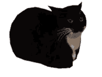

+++
date = '2026-10-13T11:44:53Z'
draft = true
title = '📦 VirtualBox en Archlinux'
tags = ["linux", "virtualbox", "archlinux"]
summary = 'Instalar virtualbox en archlinux.'
+++

> [!IMPORTANT]
Si quieres obtener información y una explicación más detallada, visita la [Arch Wiki](https://wiki.archlinux.org/title/VirtualBox_(Espa%C3%B1ol)).

## Instalar VirtualBox

Los paquetes que debes instalar son:

- `virtualbox`
- `virtualbox-host-dkms`: proporciona módulos al sistema anfitrión.
- `linux-headers`: paquete de encabezado para el kernel, para compilar los módulos de VirtualBox.

Por defecto al instalar el paquete `virtualbox`, también se instala el paquete `virtualbox-host-dkms`.

```bash
sudo pacman -S virtualbox linux-headers
```

## Cargar los módulos del kernel de VirtualBox

Los módulos de VirtualBox se cargan automáticamente al momento del arranque, gracias a `systemd-modules-load.service`.

Por lo que para cargar los módulos de VirtualBox, reinicia el sistema o cargalos manualmente.

Para cargar un módulo manualmente después de la instalación de VirtualBox, ejecutamos.

```bash
sudo modprobe vboxdrv
```
El módulo `vboxdrv` se debe cargar obligatoriamente antes de ejecutar cualquier máquina virtual.

Otros módulos:

- `vboxnetadp`: para crear la interfaz del sistema anfitrión.
- `vboxnetflt`: para iniciar una máquina virtual usando esa interfaz de red.

También podemos cargar los módulos de VirtualBox manualmente ejecutando `vboxreload`.

```bash
sudo vboxreload
```

## Añadir tu usuario al grupo vboxusers

Para usar todas las funciones de virtualbox con nuestro usuario, debemos añadir nuestro usuario al grupo `vboxusers`.

```bash
sudo usermod -aG vboxusers $USER
``` 

Para que los cambios surtan efecto cierra sesión o reinicia el sistema.

Comprueba los cambios ejecutando:

```bash
groups && grep vboxusers /etc/group
```

## Fin

En principio con esto ya puedes empezar a crear tus máquinas virtuales y darles duro contra el muro, y si no, recuerda que tienes a tu disposición la [Arch Wiki](hhttps://wiki.archlinux.org/title/VirtualBox_%28Espa%C3%B1ol%29).


